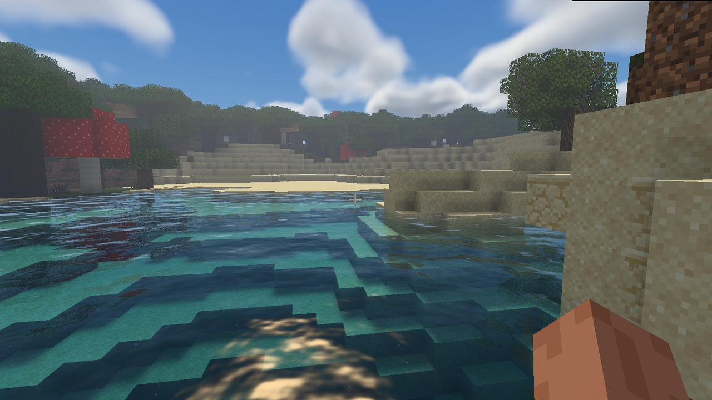

# Aurora Shaders for Horizon

Aurora is a WGSL shaderpack for the Horizon Rust client. It adds a round sun and moon, volumetric clouds, northern lights, terrain and entity lighting, shadows, and water with refraction, underwater fog and screen-space reflections.

**First public prerelease — 0.10.1-rc.1.** It requires the patched Horizon renderer with shader API `0.1-aurora-hdr.1` and Minecraft Java 26.3 resources prepared from your own installation. The client was tested on an Apple M3 Pro with Metal.



## Install

- **New installation.** Download `Aurora-RC1-source-kit.zip`, unpack it, and follow `INSTALL.md`. The kit contains the four packs and the source patches needed to build the matching client. It includes SHA-256 checksums. [Prerelease downloads](https://github.com/molchanskit-hue/aurora-shaders/releases/tag/v0.10.1-rc.1) · [Инструкция по установке](INSTALL-RC.md)
- **Existing compatible client.** Start the patched client with `AURORA_HDR_PIPELINES=1`. Unpack `Aurora-HDR-presets-0.10.1-rc.1.zip` into the folder opened by **Options → Horizon Settings → Shader Packs → Open Pack Folder**. Choose Low, Medium, High or Ultra. You can also download the individual packs from the release page.

## Performance on Apple M3 Pro

Medium uses 32 reflection steps in clear weather and 24 at full rain. In the same native-resolution shoreline view, this reduced rainy GPU frame time from 24.62 to 22.37 ms. The original and revised presets were also compared in motion.

| Rainy shoreline on Medium | Mean FPS | 1% low FPS |
|---|---:|---:|
| 1920×1080, window | 121.6 | 64.3 |
| 2560×1440, window | 83.7 | 46.0 |
| 3600×2260, fullscreen | 44.7 | 37.4 |

These are actual framebuffer sizes at an eight-chunk render distance. At 1080p the lowest of the four individual 1% low readings was 62.1 FPS. A separate 1080p route tested a freshly installed copy of each pack through forest, chunk streaming, shoreline, submersion and camera turns. Medium reached a 1% low of 56.7 FPS in the underwater interval. [Test results](reports/rc1.json) · [Forest](preview/forest.jpg) · [Rain](preview/rain.jpg) · [Underwater](preview/underwater.jpg)

## Build from this repository

The source kit is the easiest way to get both the engine and packs. To work from Git, run these commands from this repository with Git, Rust/Cargo and Python 3.11 or newer installed.

```sh
python3 tools/prepare-rc-engine.py horizon-aurora
(cd horizon-aurora && cargo build --locked --profile fast -p horizon-client -p horizon-shader-api)
python3 tools/hdr_pack.py --sdk "$PWD/horizon-aurora/target/fast/horizon-shader"
```

The builder generates and validates all four `.hshader` files and their ZIP under `dist/`. The source preparation tool verifies the patched Git tree before exposing the checkout. To run the game, prepare your Minecraft resources using JDK 25 and follow steps 2–4 of the installation guide, copying the packs from `dist/`. [Installation guide](INSTALL-RC.md)

## License

Aurora’s original shader and tool code uses the MIT license. Horizon’s license and third-party notices are included separately. [Aurora license](LICENSE) · [Horizon notices](notices/)
